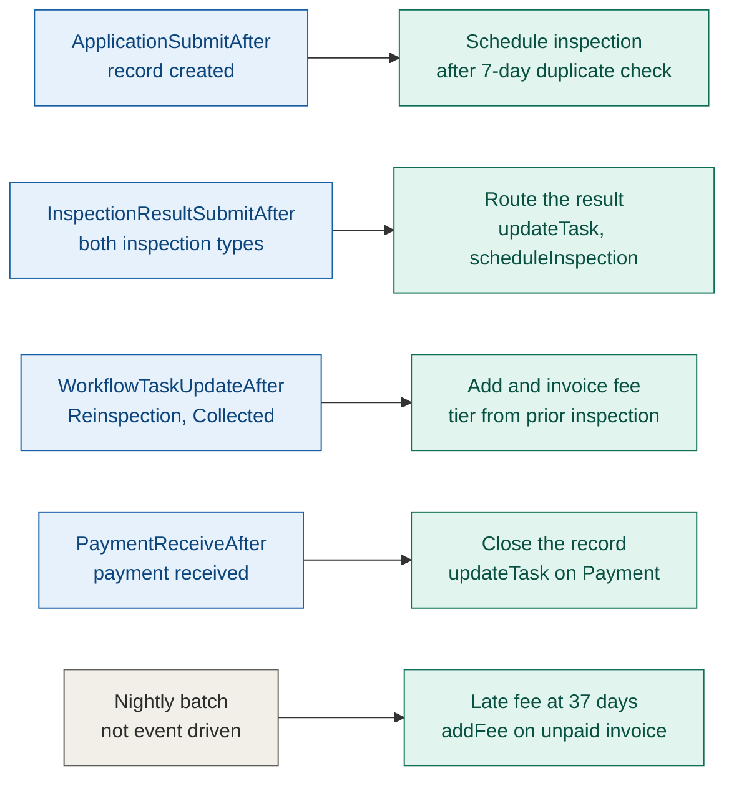

# Event chain — Skid Violation

Generated from Table E. See [RATIONALE.md](./RATIONALE.md) for why hooks and effects are
drawn as two columns rather than a chain, and why the nightly batch gets its own class.

