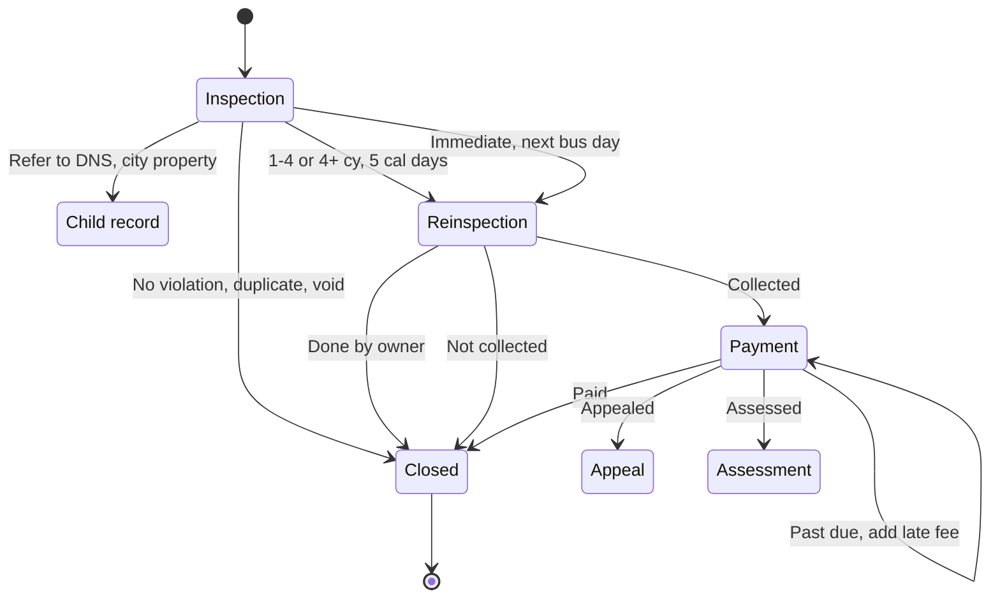

# Workflow state graph — Skid Violation

Generated from Table B. See [RATIONALE.md](./RATIONALE.md) for why the four cubic-yard
results collapse into two edges and why `Appealed`/`Assessed` are drawn as dead ends.

