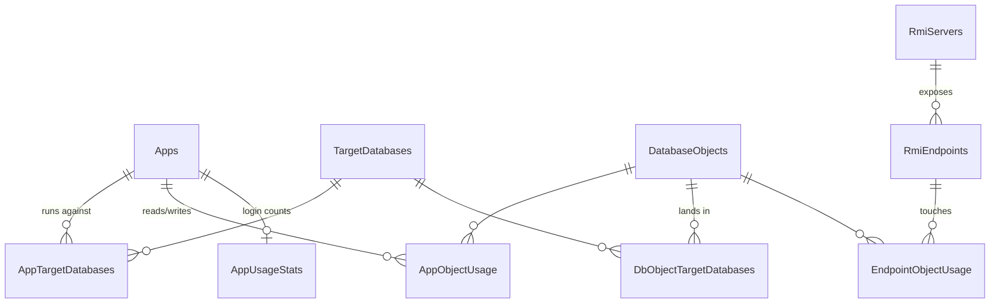

# `DatabaseMigration` on `sql-treas`

The bookkeeping database for the whole DPW Oracle → SQL Server effort. It holds no application
data — only the inventory of what exists, who uses it, and where it is going. Treat it as the
authoritative answer to "which database does this belong in?"

Connect with the profile **"sql-treas DatabaseMigration"**.

## Schemas

| Schema | Contents |
|---|---|
| `migration` | Everything that matters. Lowercase — not to be confused with Oracle's uppercase `MIGRATIONS` freeze schema. |
| `development` | Scratch (`AllConstraints` view, `QueriesThatCreateObjects`) |
| `dbo` | `HowTo` only, currently empty |

## How the Tables Relate



The two hub tables are `DatabaseObjects` (every table/view/sequence, 2 245 rows) and
`TargetDatabases` (the 38 destination databases). Almost every useful question is a join
through one of them.

## Table Groups

**Applications**

| Table | Rows | Purpose |
|---|---|---|
| `Apps` | 133 | One row per app: `app_type`, `has_mssql_peer`, `conversion_status`, call counts |
| `AppTargetDatabases` | 62 | App → target database (many-to-many) |
| `AppUsageStats` | 86 | `total_logins`, `last_used`, `is_active`, `is_obsolete` |
| `AppObjectUsage` | 23 | Access verbs and conversion status per app/object |
| `AppGenericCallUsage` | 3 650 | Generic-helper calls (`selectGeneric`, etc.) per app/object |
| `FromApplicationsInventory` | 96 | Original inventory list |

**Objects and destinations**

| Table | Rows | Purpose |
|---|---|---|
| `DatabaseObjects` | 2 245 | Object catalog: name, schema, type, `source_db`, `is_obsolete` |
| `DbObjectTargetDatabases` | 2 156 | Object → target DB, with `migration_status` and `migrated_date` |
| `TargetDatabases` | 38 | `db_name`, `sql_server` |
| `DpwpObjects` | 2 206 | Oracle-side object list |
| `DpwpObjectDependencies` | 198 | Oracle dependency graph |
| `TriggerObjectDependencies` | 257 | Trigger → table |
| `PlacementIssues` | 95 | Objects whose placement is contested or unresolved |

**RMI**

| Table | Rows | Purpose |
|---|---|---|
| `RmiServers` | 9 | The RMI server processes |
| `RmiEndpoints` | 1 654 | Interface/method signatures |
| `RmiMethodCallSites` | 13 828 | Where each method is called from |
| `EndpointObjectUsage` | 2 228 | Which objects an endpoint touches |
| `vRmiEndpointTargetDB` | view | **Authoritative** method → target DB map used by `RoutingChecker` |

**Servlets**

`ServletPage` (102), `ServletTargetDatabases` (107), `ZZ_ServletObjectScan` (316).

**Query analysis and runtime logs**

`SqlQueryInventory` (175), `CheckerQueryLog` (115 043 — captured runtime queries),
`CheckerQueryFix` (resolution tracking — `resolution_type` of `fixed`/`pending_deploy`/`wont_fix`/
`benign`, see [`query-error-triage.md`](query-error-triage.md)), `vCheckerQuerySummary`,
`RoutingFallbackLog` (61 — routing that fell through to `DPWP`, worth reviewing),
`GenericCallUpdates` (2 200).

**Empty / unused:** `Clusters`, `ClusterMembership`, `ConversionPlan`, `ServerCallsInventory`,
`AppOverlapPairs`.

## Recipe Queries

All verified working. Run from `DatabaseMigration` on `sql-treas`.

**Where does an object belong?**

```sql
SELECT o.object_name, o.object_type, td.db_name, td.sql_server,
       x.migration_status, x.migrated_date
FROM   migration.DatabaseObjects o
JOIN   migration.DbObjectTargetDatabases x ON x.object_id = o.object_id
JOIN   migration.TargetDatabases td        ON td.target_db_id = x.target_db_id
WHERE  o.object_name = 'ROADLIFE';
```

**What tables go in a given database?**

```sql
SELECT o.object_name, o.object_type, x.migration_status
FROM   migration.TargetDatabases td
JOIN   migration.DbObjectTargetDatabases x ON x.target_db_id = td.target_db_id
JOIN   migration.DatabaseObjects o         ON o.object_id = x.object_id
WHERE  td.db_name = 'RoadLife'
ORDER  BY o.object_name;
```

**Which apps use a database, and how heavily?**

```sql
SELECT a.app_name, a.app_type, a.conversion_status, u.total_logins, u.last_used
FROM   migration.Apps a
JOIN   migration.AppTargetDatabases atd ON atd.app_id = a.app_id
JOIN   migration.TargetDatabases td     ON td.target_db_id = atd.target_db_id
LEFT   JOIN migration.AppUsageStats u   ON u.app_id = a.app_id
WHERE  td.db_name = 'RoadLife';
```

**What objects does an app touch, and does it write?**

```sql
SELECT app_name, object_name, object_type, total_refs, verbs, access_pattern
FROM   migration.vw_AppObjectAccess
WHERE  app_name = 'DPW_RoadLife'
ORDER  BY total_refs DESC;
```

`access_pattern` of `READ_WRITE` is the signal that freezing the Oracle copy will break this app
if it has not been repointed.

**Which objects are shared by more than one database?**

```sql
SELECT o.object_name, n = COUNT(DISTINCT td.db_name),
       dbs = STRING_AGG(td.db_name, ', ') WITHIN GROUP (ORDER BY td.db_name)
FROM   migration.DatabaseObjects o
JOIN   migration.DbObjectTargetDatabases x ON x.object_id = o.object_id
JOIN   migration.TargetDatabases td        ON td.target_db_id = x.target_db_id
GROUP  BY o.object_name
HAVING COUNT(DISTINCT td.db_name) > 1;
```

**Which RMI method hits which database?**

```sql
SELECT interface_name, method_name, rmi_server, target_db
FROM   migration.vRmiEndpointTargetDB
WHERE  method_name LIKE '%RoadLife%';
```

## Who Actually Uses an App

`DatabaseMigration` only stores app-level totals (`AppUsageStats`). **Per-user detail lives in
`LoginDPW.DPW.APP_FREQUENT_USERS`** — same server, so a three-part join works.

```sql
SELECT TOP (20) APPLICATION, USER_NAME, LOGIN_ID, EMAIL,
       USAGE_COUNT, RANK_IN_APP, LAST_ACTIVITY_DT, CURRENTLY_GRANTED
FROM   LoginDPW.DPW.APP_FREQUENT_USERS
WHERE  APPLICATION = 'RoadLife'
  AND  LTRIM(RTRIM(ISNULL(LOGIN_ID, ''))) <> ''
ORDER  BY RANK_IN_APP;
```

This is the table to read before a cutover, to know who to notify and who will complain first.

**Building a notification list for a set of apps.** Use `IN (...)` and dedupe by person, since
the same user often appears under several apps that are cutting over together:

```sql
SELECT USER_NAME, EMAIL,
       apps = STRING_AGG(APPLICATION, ', ') WITHIN GROUP (ORDER BY APPLICATION),
       total_usage = SUM(USAGE_COUNT), last_activity = MAX(LAST_ACTIVITY_DT)
FROM   LoginDPW.DPW.APP_FREQUENT_USERS
WHERE  APPLICATION IN ('StreetSigns', 'RestrictedStreets', 'Alleys', 'AlleysSS')
  AND  CURRENTLY_GRANTED = 1
  AND  LTRIM(RTRIM(ISNULL(LOGIN_ID, ''))) <> ''
GROUP  BY USER_NAME, EMAIL
ORDER  BY total_usage DESC;
```

`CURRENTLY_GRANTED = 1` keeps the list to people who can still log in today — drop that filter
only if you want historical users too. Remember the app-name mismatch caveat below: confirm each
name in your `IN (...)` list matches `APPLICATION` exactly (e.g. `RoadLife` vs `RoadLife1`)
before trusting the list is complete.

Caveats, all measured:

- **Filter out blank logins.** 821 of 4 104 rows have no `LOGIN_ID` — unattributed activity that
  otherwise outranks every real user, including at `RANK_IN_APP = 1`.
- **App names do not match across tables.** `Apps.app_name` is `DPW_RoadLife`,
  `AppUsageStats.app_display_name` and `APP_FREQUENT_USERS.APPLICATION` are `RoadLife`.
  Joining `app_display_name` to `APPLICATION` matches 74 of 86 apps; the other 12 need mapping
  by hand. Expect variants such as `RoadLife` *and* `RoadLife1` for the same app.
- **`CURRENTLY_GRANTED`** distinguishes people who still have access from historical users.
- `APP_FREQUENT_USERS` is one of the three tables that exist only in SQL Server, with no Oracle
  counterpart — so it is never a `syncTable` target.

## Gotchas

- Cross-database joins on `sys.*` or on `LoginDPW` need `COLLATE DATABASE_DEFAULT` when
  aggregating or comparing name columns.
- `conversion_status` is often blank; absence is not evidence of "not converted".
- An object present in `DPWP` may still be migrated — staging copies persist during the
  transition. `DbObjectTargetDatabases.migration_status` is the real answer.
- `RoutingFallbackLog` accumulating rows means something is routing to `DPWP` by fallback rather
  than by an explicit mapping. Worth checking after any RMI change.
